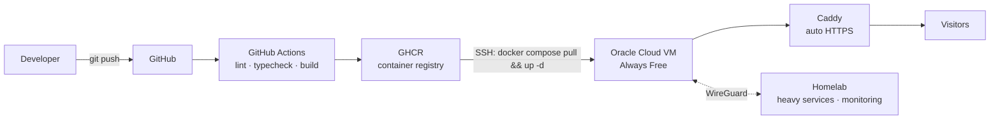

# My Portfolio — full-stack + self-hosted CI/CD

[](https://github.com/seanneol88/My-portfolio/actions/workflows/ci.yml)
[](https://github.com/seanneol88/My-portfolio/actions/workflows/deploy.yml)
[](https://nextjs.org)
[](https://www.docker.com)

> The portfolio site **is** the project: a Next.js app containerized with
> Docker, built by GitHub Actions, and self-deployed to my own Oracle Cloud
> VM behind Caddy HTTPS. Every push to `main` redeploys automatically.

**Live:** https://your-domain.com <!-- TODO: update after first deploy -->

---

## Architecture



## Tech stack

| Layer       | Choice                                   |
| ----------- | ---------------------------------------- |
| Framework   | Next.js 16 (App Router) + React 19       |
| Styling     | Tailwind CSS v4                          |
| Language    | TypeScript                               |
| Runtime     | Node.js 22, standalone output            |
| Container   | Docker (multi-stage build)               |
| CI/CD       | GitHub Actions → GHCR → SSH deploy       |
| Edge        | Caddy (automatic HTTPS via Let's Encrypt)|
| Hosting     | Oracle Cloud Always Free VM + homelab    |

## Quickstart

```bash
npm install
npm run dev        # http://localhost:3000
```

Production, exactly like the server runs it:

```bash
docker compose up -d --build              # app only, on :3000
DOMAIN=yourdomain.com docker compose --profile edge up -d   # + Caddy HTTPS
```

## Deploying

The site auto-deploys on every push to `main`. Full step-by-step Oracle Cloud
setup (VM, firewall, DNS, secrets) lives in **[docs/DEPLOYMENT.md](docs/DEPLOYMENT.md)**.

## Editing content

Everything on the page — name, skills, projects, stats, links — is driven by a
single file:

```
src/data/portfolio.ts   ←  edit this, never touch the components
```

## Repo layout

```
├── src/
│   ├── app/              # Next.js pages, layout, global styles
│   ├── components/       # Nav, Hero, Skills, Projects, Infrastructure, Contact, Footer
│   └── data/portfolio.ts # ALL site content (single source of truth)
├── .github/workflows/    # ci.yml (lint+build) · deploy.yml (GHCR → Oracle VM)
├── deploy/Caddyfile      # reverse proxy + automatic HTTPS
├── docs/                 # deployment walkthrough
├── Dockerfile            # multi-stage standalone build
└── docker-compose.yml    # app + optional Caddy edge profile
```

## Roadmap

- [x] Portfolio site with CI/CD + self-hosted deployment
- [ ] **Saku** — expense & gig-income tracker (RM-native, PostgreSQL)
- [ ] Homelab status dashboard (Uptime Kuma + custom API)
- [ ] Blog section — write-ups of everything I break and fix

## Why self-hosted?

Because it proves the thing a screenshot cannot: that I can build **and** ship
— DNS, TLS certificates, containers, CI pipelines, the whole path from
`git push` to a page loading in someone's browser.
